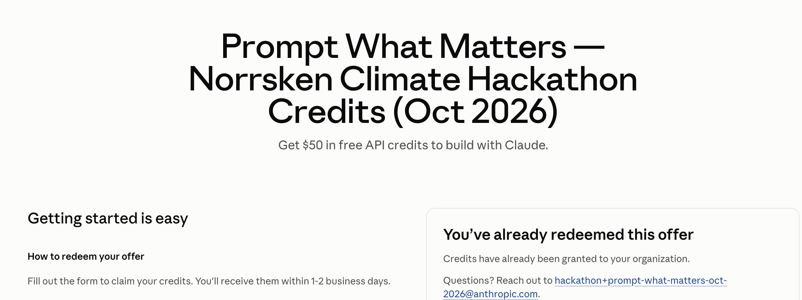

# Claiming Claude API Credits

Source: https://app.notion.com/p/norrskenfoundation/Fixathon-at-Impact-Week-3994b2eeb66380f39ce7f4d71299369c

As part of the Norrsken Fixathon at Impact Week, every participant gets **$50 in Claude API credits**. This page explains what the credits are, how to set up your Claude Console account and Claude Code before the event, and how to claim and use your credits on the day.

>
> 🚫 **Note: **the claiming link we will share is exclusively for Fixathon participants, don't share it with anyone else! The accounts claiming the credits will be tracked.
>

#### What are the Claude Console and API credits?

- **Claude Console** ([platform.claude.com](https://platform.claude.com/)) is Anthropic's site for developers. It's where you manage API usage and billing.
- **API credits:** every participant gets **$50 in Claude API credits**. They go to your Console account and can be used with Claude Code.
- **How it works:** on **October 13**, the first day of the Fixathon, we'll share a link where you can claim your credits. Once you've claimed them, you can use them in Claude Code, either in the terminal or in Visual Studio Code. **Reminder: Don’t share the link with anyone!**
- **The credits don't work on Claude.ai** (the Claude chat website or app). Your Console account is separate from any Claude.ai subscription (Pro/Max).

#### Before the event: get set up!

To be ready on day one, do these things before the Fixathon: **create a Claude Console account**, which you need to claim the credits, and **install Claude Code**, which is where you'll use them.

>
> ❗ You can only use the credits **in Claude Code in the terminal or in VS Code**, so if you haven't used either before, please set one up in advance (see below).
>

>
> 💡 **Already have a Console account (not the same as a Claude.ai subscription) and use Claude Code?** Perfect! You can skip Steps 1 and 2 (below). Just update Claude Code to the latest version, then do Step 3 to check you're signed in to your Console account.
>

**Step 1: Create a Claude Console account**

- Create your Console account at [platform.claude.com](https://platform.claude.com/login). It's free, so if you're asked to add payment or buy credits, you can skip that step.
- **Remember which email you used.** You'll need the same email to claim your credits.

>
> ℹ️ **Completely new to the Console and Claude Code?** It might be worth adding a few euros to your Console account get familiar with the setup before the event.
>

**Step 2: Install Claude Code (Terminal (Mac) or PowerShell (Windows)**

To use your credits, you'll need Claude Code, either in the terminal or as an extension in VS Code. The credits don't work in the Claude.ai app or chat.

**Option A: Use Claude Code in the terminal**

1. Open **Terminal** (Mac) or **PowerShell** (Windows). New to the terminal? Anthropic's [terminal guide](https://code.claude.com/docs/en/terminal-guide) shows you how to open it.
2. Copy & paste the command for your computer into Terminal or PowerShell, then press Enter:
  - **Mac:** `curl -fsSL https://claude.ai/install.sh | bash`
  - **Windows (PowerShell):** `irm https://claude.ai/install.ps1 | iex`
3. Close Terminal or PowerShell, open it again, type `claude --version` and press Enter. If a version number appears, it worked.

>
> 📺 Prefer a video? Search YouTube for "install Claude Code terminal Mac" or "install Claude Code Windows" for step-by-step walkthroughs.
>

**Option B: VS Code (a visual app with buttons and menus)**

1. Download and install VS Code for free from code.visualstudio.com.
2. Open VS Code and click the **Extensions** icon in the left sidebar, or press `Cmd+Shift+X` on Mac or `Ctrl+Shift+X` on Windows.
3. Search for **"Claude Code"**, find the official extension from **Anthropic**, and click **Install**.
4. Open Claude Code by clicking the **spark icon ✻**. You'll find it in the left sidebar, and in the top-right corner whenever you have a file open.

>
> 📺 Prefer a video? Search YouTube for "install Claude Code VS Code" for step-by-step walkthroughs.
>

>
> 👉 **Want to learn more?** Anthropic's [official quickstart guide](https://code.claude.com/docs/en/quickstart) shows you how to install Claude Code, start your first session and make your first changes, step by step. If you're completely new, the free [Claude Code 101 course](https://academy.claude.com/courses/claude-code-101) on Claude Academy is a good way to get comfortable before the Fixathon.
>

**Step 3: Sign in to Claude Code with your Console account**

1. **Open Claude Code:**
  - **In the terminal:** type `claude` and press Enter.
  - **In VS Code:** click the spark icon ✻ and then **Sign in**.
2. When it asks which account to use, choose the **Console account** option, not Claude.ai.
3. If it then asks how you want to sign in, choose **Sign in with your Console account** (marked "recommended"). A browser window opens so you can log in. Afterwards, go back to VS Code or the terminal.
4. **Check that it worked:** type `/status`. It should show your Console account and email.
5. **Added a few euros?** Ask Claude something simple, like "What files are in this folder?", to check it works.

>
> ❗ **Signed in with a different account,** such as a Claude.ai subscription? Type `/logout`, then `/login`. Choose the Console account option, then Sign in with that account.
>

>
> 💡 **Note:** many tutorials show signing in with a Claude.ai account. For the Fixathon, choose the **Console account** option instead.
>

#### **On the day (October 13th): claim your credits!**

1. At the Fixathon on October 13, we’ll share the claim link with you.
2. Open the link in your browser. You’ll either go straight to the credit redeem page, or you’ll need to sign in to your Claude Console account first.
3. Then fill out the redeem form with **the same email as your Console account**. The page looks like this:
  
4. Once you’ve filled out the form, you’ll be approved within a few minutes and get a confirmation email.
5. Your credits are valid for 90 days from the day you claim them.
6. Open Claude Code, type `/status` to check that you’re signed in to the same Console account, and start building!

>
> 🚫 **Don't share the claim link with anyone.** It's only for Fixathon participants.
>

#### Tips for building?

- **Switch to a cheaper model.** Claude Code starts on Opus, the most capable but also the most expensive model. To make your $50 last longer, type `/model sonnet` to switch to Sonnet, which handles most everyday coding tasks well at a fraction of the price. Type `/model` on its own to see all models with their prices.
- **Keep an eye on your spending.** Type `/usage` to see what your current session has cost. For your total spend and remaining credits, check the Usage and Billing pages at platform.claude.com.
- **You don't need an API key.** Signing in with your Console account (Step 3) is all Claude Code needs. If you create an API key for an app you're building, keep it out of your code and never share it publicly. Anyone with your key can spend your credits.
- **Coding together on several laptops?** Share your project on **GitHub**, a free website that stores your team's code online so everyone works on the same project instead of separate copies. Everyone who codes needs a free account at github.com (Windows users also need to install Git from git-scm.com).
  1. **One person:** create a folder for your project, open it in Claude Code and ask: *"Put this project on GitHub as a private repository and invite my teammates [their GitHub usernames]."* Claude Code will walk you through it and give you a link.
  2. **Everyone else:** accept invitation from GitHub (you'll get an email), then open Claude Code and ask: *"Download this GitHub project to my computer and open it: [link]."*
  3. **Share your work often:** ask Claude Code to *"save my changes and upload them to GitHub"*, and to *"get the latest changes from GitHub"* to see your teammates' work. Work on different parts of the project so your changes don't clash.

#### Need help?

>
> 👉 **Problems claiming your credits on the day of the event? **Email hackathon+prompt-what-matters-oct-2026@anthropic.com
>
