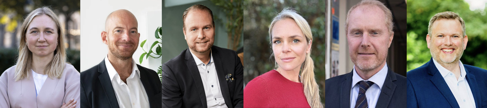

# Experts, Jury & Evaluation Criteria

Source: https://app.notion.com/p/norrskenfoundation/Fixathon-at-Impact-Week-3994b2eeb66380f39ce7f4d71299369c

>
> ✅ We have invited experts for the feedback session on October 14th, and a special jury for the final pitches on October 15th. See their names and profiles below.
>

#### **Experts for the Feedback Session on October 14th (12:30)**

1. Charmian Love: Global Ambassodor Natura | [LinkedIn](http://linkedin.com/in/charmian-love)
2. Jahed Momand: Co-Founder & General Partner, Cerulean Ventures | [LinkedIn](http://linkedin.com/in/jahedmomand)
3. Hanna Grahn: Head of Sustainability & Climate Action, Spotify | [LinkedIn](http://linkedin.com/in/hanna-grahn-08668542)
4. Thomas Annicq: CEO & Co-Founder, OneShot | [LinkedIn](http://linkedin.com/in/thomasannicq)
5. Michael Langguth, Founding Partner, Carbon 13 | [LinkedIn](http://linkedin.com/in/langguthmichael)
6. Tsvetelina Kuzmanova: EU Sustainable Finance Policy Lead,** **CISL [LinkedIn](http://linkedin.com/in/tskuzmanova)
7. Katarina Wangler Björk: Chief Impact Officer, Exponential Roadmap | [LinkedIn](http://linkedin.com/in/katarinabjork)
8. Iris ten Have: Founding Partner, Visionaries Tomorrow | [LinkedIn](http://linkedin.com/in/iris-ten-have)
9. Carmel Rafaeli: Founding Partner, The Table VC | [LinkedIn](http://linkedin.com/in/carmelrafaeli)
10. Mattias Frumerie: Sweden's Climate Ambassador & Head of Delegation to UNFCCC | [LinkedIn](http://linkedin.com/in/mattiasfrumerie)
11. Magnus Jern: Co-Founder, p30.ai | [LinkedIn](http://linkedin.com/in/magnusjern)
12. Anna Lerner Nesbitt: CEO, Climate Collective | [LinkedIn](http://linkedin.com/in/anna-lerner-nesbitt)
13. Cecilia McAleavey: VP Global Public Affairs, Oatly | [LinkedIn](http://linkedin.com/in/cecilia-mcaleavey-a2607236)
14. Daniel Albertsson: Chief Digital & Innovation Officer, Advania | [LinkedIn](http://linkedin.com/in/dalbertsson)
15. Jakob Ökvist: Digital & Innovation Developer, Advania | [LinkedIn](http://linkedin.com/in/jakob-ökvist-4bb446a5)

#### **Jury for the Final Pitches on October 15th (14:10)**

1. Hanna Grahn: Head of Sustainability & Climate Action, Spotify | [LinkedIn](http://linkedin.com/in/hanna-grahn-08668542)
2. Jakob Ökvist: Digital & Innovation Developer, Advania | [LinkedIn](http://linkedin.com/in/jakob-ökvist-4bb446a5)
3. Daniel Albertsson: Chief Digital & Innovation Officer, Advania | [LinkedIn](http://linkedin.com/in/dalbertsson)
4. Anna Lerner Nesbitt: CEO, Climate Collective | [LinkedIn](http://linkedin.com/in/anna-lerner-nesbitt)
5. Mattias Frumerie: Sweden's Climate Ambassador & Head of Delegation to UNFCCC | [LinkedIn](http://linkedin.com/in/mattiasfrumerie)
6. Thomas Lingard: CEO, Centre for Future Generations | [LinkedIn](http://linkedin.com/in/thomaslingard)

#### Climate & AI Panel: **Getting from COP21 to COP31**

1. Sophie Dembinski: Managing Director, Norrsken Foundation Brussels | [LinkedIn](https://www.linkedin.com/in/sophie-dembinski-063a5239/)
2. Olivia Lazard: Founder, Transition Intelligence; UK Climate Security Task Force | [LinkedIn](https://www.linkedin.com/in/olivia-lazard/)
3. Dorothy Chou: Strategic Advisor, Google DeepMind; Angel Investor | [LinkedIn](https://www.linkedin.com/in/dorothychou-/)

#### **Evaluation Criteria: Before and During the Pitches**

>
> 💡 Your solutions will first be reviewed by a sub-jury (Norrsken, Mattias Frumiere, and Hanna Grahn), who will select the finalist teams. After the final pitches on stage, the jury will choose the winning team. See the criteria below (D applies only to the pitches).
>

**A. Problem**

- Is the problem specific, real, and clearly defined rather than vague?
- Does the team understand why it hasn’t been solved yet and who it affects?

**B. Solution and AI**

- Is the solution the right answer to the problem?
- What role do AI and technology play: genuinely central, or just a buzzword?
- Which data and sources did the team build on, and are they credible?
- Is the prototype a convincing first step toward a real solution?

**C. Impact and Path Forward**

- Who benefits, and how big would the impact be if it works?
- Is it feasible, with a clear market and a way to fund it?
- Could it grow beyond the Fixathon?

**D. Team and Pitch**

- Is this the right team to take it forward?
- Was the pitch clear and compelling?
- Did the team answer the jury’s questions well?
